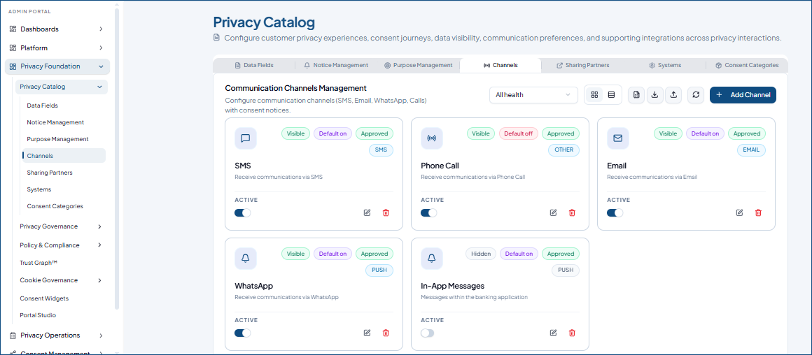

---
layout:
  width: default
  title:
    visible: true
  description:
    visible: false
  tableOfContents:
    visible: true
  outline:
    visible: false
  pagination:
    visible: true
  metadata:
    visible: false
  tags:
    visible: true
  actions:
    visible: false
  anchors:
    visible: true
---

# Channels

Configure the communication channels through which customers receive communications. Add all your preferred communication channels (SMS, Email, WhatsApp, App Push Notifications, and more) here, so you can collect customer preferences which channels would prefer for business-related communications.

Configured channels are displayed as summary cards displaying the channel name, key, description, default state, and channel status.

To access, got to **Privacy Foundation** > **Privacy Catalog** > **Channels**

<figure><figcaption></figcaption></figure>

### Add a New Channel

* Select **Add Channel**.
* Enter the **Channel Name, Key** (a unique identifier), and **Description**.
* Configure consent notice message to tell the system what to display when users attempt to enable (**grant**) or disable (**revoke**) a channel.&#x20;
* Specify the default consent behavior when no response is received
* Set the **Default status** (Enabled/Disabled)
* Then, select **Create Notice** to save it.

> Alternatively, you can pick a default channel from the right pane and customize it as required.

<figure><figcaption></figcaption></figure>

#### Adding Channels in Bulk

To add multiple channels at once, select **Download Excel Template** () to download the template. Enter the fields details in the specified format and save the file.

Then, select **Import** () and upload the excel file.&#x20;

### Manage Channels

* Use Visibility toggle to enable or disable the channel's visibility in the customer portal.
* To edit a channel, select **Edit** (.png>)) on the card. Make necessary changes and update.
* Use **Delete** () to remove a channel that is no longer required.
* Use **Refresh** () to load all the channels configured to date.
* To export the channels to an excel file, select **Export** ().
* To rearrange, hover over a channel and use this icon (.png>)) to drag and place it in the required position.
* Switch between **Cards View** () and **Table View** () to display the notices in your preferred layout.

<mark style="color:$warning;">**Queries**</mark><mark style="color:$warning;">:</mark>

* <mark style="color:$warning;">Cards do not display the health status. Then, how can we filter the cards by health?</mark>
* <mark style="color:$warning;">Cards show the tag "Approved" but there is no approval process involved. And if all are approved by default, what is the significance in displaying this tag?</mark>
