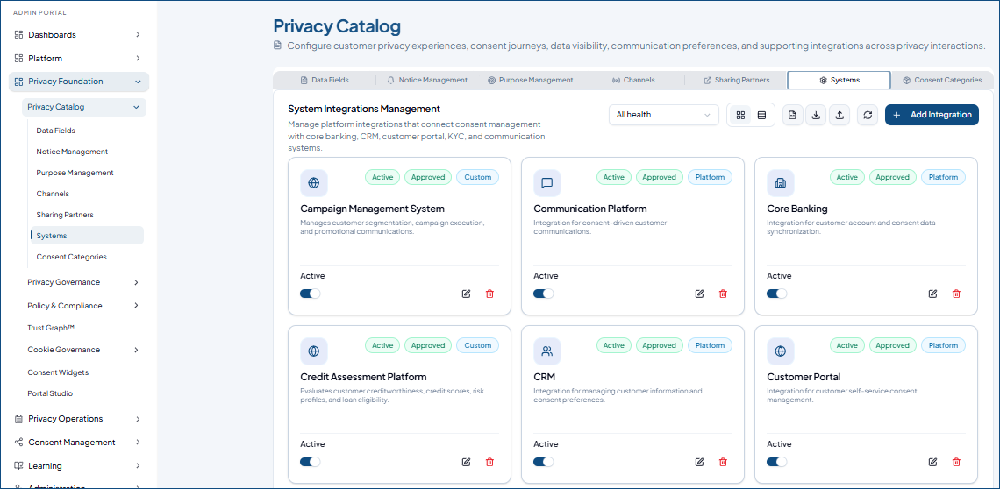

---
layout:
  width: default
  title:
    visible: true
  description:
    visible: false
  tableOfContents:
    visible: true
  outline:
    visible: false
  pagination:
    visible: true
  metadata:
    visible: false
  tags:
    visible: true
  actions:
    visible: false
  anchors:
    visible: true
---

# Systems

This lets you configure integrations between the Consent Management Platform (CMP) and external systems, such as core banking, CRM, KYC, and campaign management platforms. It helps you define what personal information is shared with each system, map data fields to the appropriate sources, and configure data governance settings.

These integrations help organizations maintain visibility into how customer data flows between systems, support privacy governance, and manage data sharing in line with their data protection requirements under the Digital Personal Data Protection (DPDP) Act.

To access, got to **Privacy Foundation** > **Privacy Catalog** > **Systems**

<figure><figcaption></figcaption></figure>

### Add a New System

* Select **Add Integration**.
* In the **Platform Type** field, select the type of system you want to integrate, such as a KYC platform.
* Enter the **Integration Name** and **Description** to identify the integration and explain its purpose.
* Under **Data Governance**,&#x20;
  * Select the personal information fields the system can access.
  * Select **Add mapping** to map each selected data field to its data source, connector, and output parameter.&#x20;
  * The **Risk Level** is automatically assigned based on the selected personal information fields and their sensitivity settings.
  * Select the applicable status of the Data Processing Agreement (DPA)
  * Specify the region where the integration processes customer data.
* Then, select **Create Integration**.

<figure><figcaption></figcaption></figure>

#### Adding Integrations in Bulk

To add multiple integration systems at once, select **Download Excel Template** () to download the template. Enter the fields details in the specified format and save the file.

Then, select **Import** () and upload the excel file.&#x20;

### Manage Integrations

* Use Visibility toggle to enable or disable the integrated system's visibility in the customer portal.
* To edit an integration, select **Edit** (.png>)) on the card. Make necessary changes and save changes. Run the assessment to evaluate the privacy risks associated with sharing personal data with the external systems or service providers.&#x20;
* Use **Delete** () to remove a integration that is no longer required.
* Use **Refresh** () to load all the integrations added to date.
* To export the integrations list to an excel file, select **Export** ().
* Switch between **Cards View** () and **Table View** () to display the integrations in your preferred layout.
